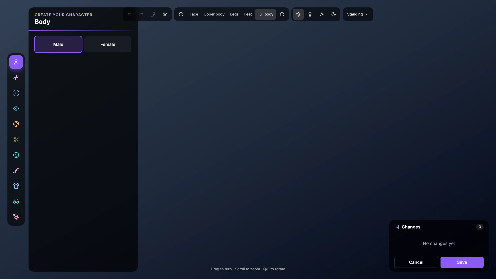
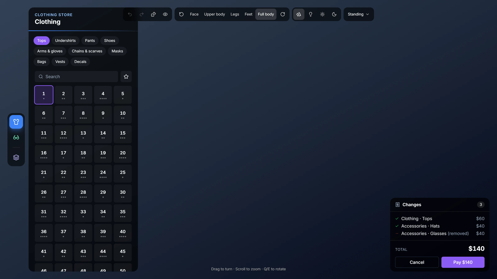
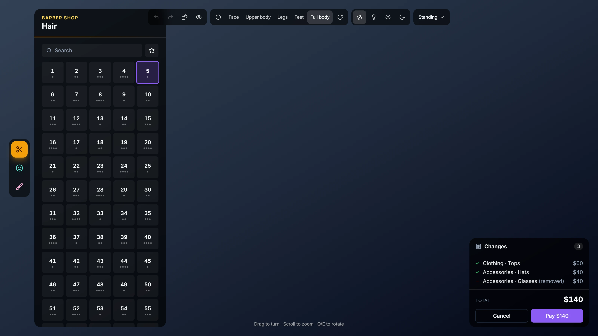
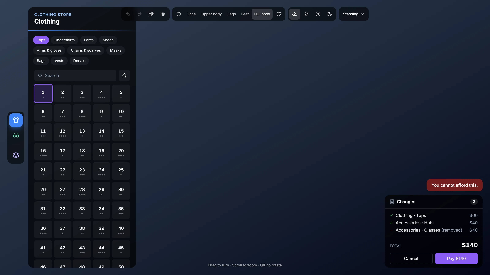

<div align="center">

# ⬢ ug-appearance

**Character creator, clothing stores, barbers, tattoo parlors, surgeons, outfits and uniforms for the UgCore Framework.**

[](https://ugcore.urging.ch/ug-appearance/introduction)
[](https://github.com/ugcore-project/ug-appearance/actions/workflows/ci.yml)
[](https://github.com/ugcore-project/ug-appearance/releases/latest)
[](LICENSE)
[](https://discord.gg/pCJUcyVw5X)

[**Documentation**](https://ugcore.urging.ch/ug-appearance/introduction) · [**Installation**](https://ugcore.urging.ch/ug-appearance/installation) · [**Configuration**](https://ugcore.urging.ch/ug-appearance/configuration) · [**Integration**](https://ugcore.urging.ch/ug-appearance/integration)


</div>

---

ug-appearance is where players shape how their characters look. Every store opens the same live studio around the player's ped: the camera follows the edit, every change shows at once, and the bill is always visible.

The server decides what a store may change, what it costs and what is saved, from its own copy of the appearance. The page only shows and asks.

## Features

- 🎬 **Live studio.** The camera frames what you edit: hair frames the face, shoes frame the feet. Drag to turn, scroll to zoom, `Q` and `E` to rotate.
- 👀 **Preview on hover.** Styles, colors and tattoos show on the ped before you click. No thumbnails: the ped is the preview.
- 🧱 **Grids, not lists.** Numbered cards with search, favorites and a "none" card for accessories. Type a number to jump straight to it.
- 💡 **Poses and lights.** Raise the hands to see how a top falls. Natural, studio, day and night light.
- ↩️ **Compare and history.** Hold to see the saved look, undo and redo 50 steps, randomize a category.
- 💸 **Optional economy.** With ug-core's accounts module, changes cost money, priced on the server. Without it, everything is free.
- 👕 **Outfits and uniforms.** Save, wear, replace and rename outfits. Job and gang uniforms by grade, worn for free.
- 🧍 **Store clerks.** Optional NPCs at your stores, spawned only near the player.
- 🎯 **ug-target support.** Set `interaction = 'target'` to open stores by aiming at them or their clerk, with [ug-target](https://github.com/ugcore-project/ug-target), instead of pressing `E`.
- 🖋️ **Tattoo parlors undress the preview,** so tattoos on the body show. The clothes come back on close.
- 🧑‍🎨 **Character creator** for [ug-multicharacter](https://github.com/ugcore-project/ug-multicharacter), and an admin editor for staff.

## Store kinds

| Kind | Edits | Pays |
| --- | --- | --- |
| Clothing store | Clothes and accessories, outfits and uniforms | Per changed piece |
| Barber shop | Hair, facial hair and makeup | Hair once, each other piece |
| Tattoo parlor | Tattoos by body zone | Per added and per removed tattoo |
| Plastic surgeon | Heritage, face, eyes and skin | Once per changed category |
| Wardrobe | Outfits and uniforms only | Free |
| Creator | Everything, while creating a character | Free |
| Admin editor | Everything, opened with a command | Free |

## Preview

| Character creator | Clothing store |
| :---: | :---: |
|  |  |

| Barber | Refused by the server |
| :---: | :---: |
|  |  |

## Requirements

- FXServer with **OneSync**
- [**ug-core**](https://github.com/ugcore-project/ug-core) 1.0.0 or newer, with the **characters** module enabled
- [**ug-lib**](https://github.com/ugcore-project/ug-lib) 1.0.0 or newer
- [**oxmysql**](https://github.com/overextended/oxmysql)

ug-core's **accounts**, **jobs** and **gangs** modules are optional. They add prices, job uniforms and gang uniforms.

## Installation

1. Download `ug-appearance.zip` from the [latest release](https://github.com/ugcore-project/ug-appearance/releases/latest) and extract it into your `resources` folder, for example `resources/[ug]/ug-appearance`. The archive holds the built page. To update, extract the new one over it: your `config.lua` stays.

2. Add it to `server.cfg`, after its dependencies and before `ug-multicharacter`:

   ```bash
   ensure oxmysql
   ensure ug-lib
   ensure ug-core
   ensure ug-appearance
   ensure ug-multicharacter

   # Lets admins open the editor with /appearance.
   add_ace group.admin ug-appearance.admin allow
   ```

3. Start the server. ug-appearance generates `config.lua` from `server/config.default.lua` and creates its tables, `ug_appearances` and `ug_outfits`.

See the [installation guide](https://ugcore.urging.ch/ug-appearance/installation) for details.

## Configuration

`config.lua` is yours. It is generated on the first start, never overwritten by updates, and checked on every start: any error is logged with its path, and the resource stays idle instead of half working.

```lua
stores = {
    { id = 'binco', kind = 'clothing', coords = vector3(73.9, -1392.9, 29.4), blip = true, ped = true },
    { id = 'mrpd', kind = 'wardrobe', coords = vector3(461.4, -998.0, 30.7), job = 'police', blip = false },
},
prices = { component = 60, prop = 40, hair = 80, tattoo = 150 },
payment = { accounts = { 'cash', 'bank' } },
```

### Look and tools

| Key | What it changes |
| --- | --- |
| `theme` | ug-lib theme overrides for the editor only. `colors` also takes one color per tab (`model`, `heritage`, `features`, `eyes`, `skin`, `hair`, `facialHair`, `makeup`, `clothing`, `accessories`, `tattoos`, `outfits`) and the heritage mix bar (`mixFirst`, `mixSecond`). The lighter shade and text color of a tab follow on their own. |
| `layout` | `side` (`left` or `right`), `width` in rem, `opacity`, `blur`, `toolbar` (`top` or `bottom`), `hint`, `animations`, `resultDuration`. Keys you leave out keep their default. |
| `features` | `undo`, `randomize`, `compare`, `favorites`, `search`, `cameras`, `rotate`, `zoom`, `poses`. `false` hides the tool; turning, zoom, compare and poses are refused by the game too. |
| `controls` | `dragSpeed`, `zoomSpeed`, `keyRotate` (`0` turns Q and E off) and `rotateStep`. |
| `lights` | The light presets on the toolbar, in order. The first one is on when the editor opens. |
| `studio` | `dayHour`, `nightHour` and the studio lamps: `{ angle, distance, height, color, range, intensity }`. |
| `camera.zoomDuration` | How long a zoom step glides, in ms. |
| `soundEffects` | `save` and `error` game sounds, `{ name, set }`. A sound left out is silent. |

See [Configuration](https://ugcore.urging.ch/ug-appearance/configuration) and [Stores and uniforms](https://ugcore.urging.ch/ug-appearance/stores).

## Integration

```lua
-- Server: open a store from your own resource, such as housing or a job.
exports['ug-appearance']:OpenStore(source, 'clothing', { free = true })
exports['ug-appearance']:OpenWardrobe(source)

-- Server: read and change worn pieces, such as an inventory with clothing slots.
local clothing = exports['ug-appearance']:GetClothing(source)
exports['ug-appearance']:SetClothing(source, { props = { hat = { drawable = -1, texture = 0 } } })

-- Client: dress a preview ped.
exports['ug-appearance']:Apply(ped, appearance)
```

See [Integration](https://ugcore.urging.ch/ug-appearance/integration) for every export.

## Console

| Command | Does |
| --- | --- |
| `/appearance [id]` | Opens the full editor for yourself or a player. Needs `ug-appearance.admin`. |
| `appearance <id>` | The same from the server console. |
| `ugap status` | Open editor sessions with the player, the store and for how long. |

## Project structure

```text
ug-appearance/
├── fxmanifest.lua
├── shared/              enums and the appearance model: schema, diff, prices
├── server/              config, database, sessions, payment, outfits, commands
├── client/              ped natives, studio camera and lights, editor, stores, NUI bridge
├── locales/             en, pt
├── web/                 React page: the studio UI
├── tests/               Lua 5.4 tests with native mocks, never shipped
├── skills/              task guides for AI agents, never shipped
├── AGENTS.md            rules for AI agents and humans
└── CLAUDE.md            points Claude Code to AGENTS.md
```

## Development

Clone ug-core and ug-lib next to this repository: the tests and the type check read them from `../ug-core` and `../ug-lib`, or from the `UG_CORE` and `UG_LIB` paths.

Every change MUST pass these checks. CI runs them on pushes and pull requests to `dev` and `main`.

```bash
# 1. LuaLS strict check, zero problems, with ug-core and ug-lib as libraries
lua-language-server --check . --checklevel=Information --configpath=.luarc.json

# 2. Runtime tests
for suite in tests/*.lua; do [ "$suite" = tests/helpers.lua ] || lua5.4 "$suite" || exit 1; done

# 3. Manifest and license headers
lua5.4 .github/scripts/check-repository.lua
```

The page needs Node.js 20.19 or newer:

```bash
cd web
npm ci
npm run lint && npm run typecheck && npm test
npm run build && npm run budget   # web/dist, at most 400 KB gzipped
npm run dev                       # browser preview with buttons that play the showcase scenes
npm run capture                   # README images from the scenes, to .github/assets
```

The README images come from the scenes in `web/src/dev/scenes.ts`: see [skills/readme-preview](skills/readme-preview/SKILL.md).

For editor support, install the [Lua](https://marketplace.visualstudio.com/items?itemName=sumneko.lua) and [CfxLua](https://marketplace.visualstudio.com/items?itemName=overextended.cfxlua-vscode) VS Code extensions.

### Conventions

- Lua 5.4. Every file starts with the license header. Every function has LuaLS annotations.
- Net events and callbacks go through ug-core with a schema and a rate limit. Clients send intent, never prices or results.
- Magic values live in `UgAp.Enums`. NUI enums MUST match `web/src/types/protocol.ts`: `tests/nui.lua` fails when they differ.
- Defaults live in `server/config.default.lua` only, with a comment owners understand.
- Every player-facing text goes through `locales/`. Every locale file has the same keys as `en.json`.

### Working with AI agents

[AGENTS.md](AGENTS.md) holds the conventions and security rules every agent MUST follow. Claude Code reads it through
`CLAUDE.md`; Codex, Cursor and others read `AGENTS.md` directly. Task guides:

| Skill | For |
| --- | --- |
| [server-actions](skills/server-actions/SKILL.md) | Callbacks and net events |
| [nui-page](skills/nui-page/SKILL.md) | The page, its messages and callbacks |
| [config](skills/config/SKILL.md) | Owner config options |
| [database](skills/database/SKILL.md) | MySQL through oxmysql |
| [testing](skills/testing/SKILL.md) | Lua and web tests |
| [readme-preview](skills/readme-preview/SKILL.md) | README features and images |
| [ug-core-api](skills/ug-core-api/SKILL.md) | What ug-core and ug-lib offer |

### Releases

Releases are automated. release-please keeps a `chore: release X.Y.Z` pull request open on `main` that bumps
`version` in `fxmanifest.lua` and `CHANGELOG.md` from Conventional Commits. Merging it tags `vX.Y.Z`, builds the page
and attaches `ug-appearance.zip` with only what a server runs. Every push to `dev` replaces the `dev-build` pre-release.
Merge `dev` into `main` with a merge commit, never squash. Commit subjects become the changelog: write them for owners.

## Contributing

Contributions are welcome. Branch off `dev` and open a pull request to `dev`.

- Commits and PR titles follow [Conventional Commits](https://www.conventionalcommits.org): lowercase imperative subject, no trailing period, 72 characters at most. Scopes: `core`, `editor`, `studio`, `stores`, `outfits`, `nui`, `web`, `config`, `locale`, `ci`, `deps`.
- Add or extend a test for every change in behavior.
- Translations are welcome: copy `locales/en.json` to your language code and translate the values.

Read the [contributing guide](https://github.com/ugcore-project/.github/blob/main/CONTRIBUTING.md) and the [Code of Conduct](https://github.com/ugcore-project/.github/blob/main/CODE_OF_CONDUCT.md).

## Security

Never report a vulnerability in a public issue. [Report it privately](https://github.com/ugcore-project/ug-appearance/security/advisories/new) and read the [Security Policy](https://github.com/ugcore-project/.github/blob/main/SECURITY.md).

## Credits

Inspired by [illenium-appearance](https://github.com/iLLeniumStudios/illenium-appearance). ug-appearance is a new implementation built on UgCore's rules.

## License

ug-appearance is free software, licensed under the [GNU General Public License v3.0](LICENSE).

Copyright (C) 2026 UgCore Framework & Contributors.
